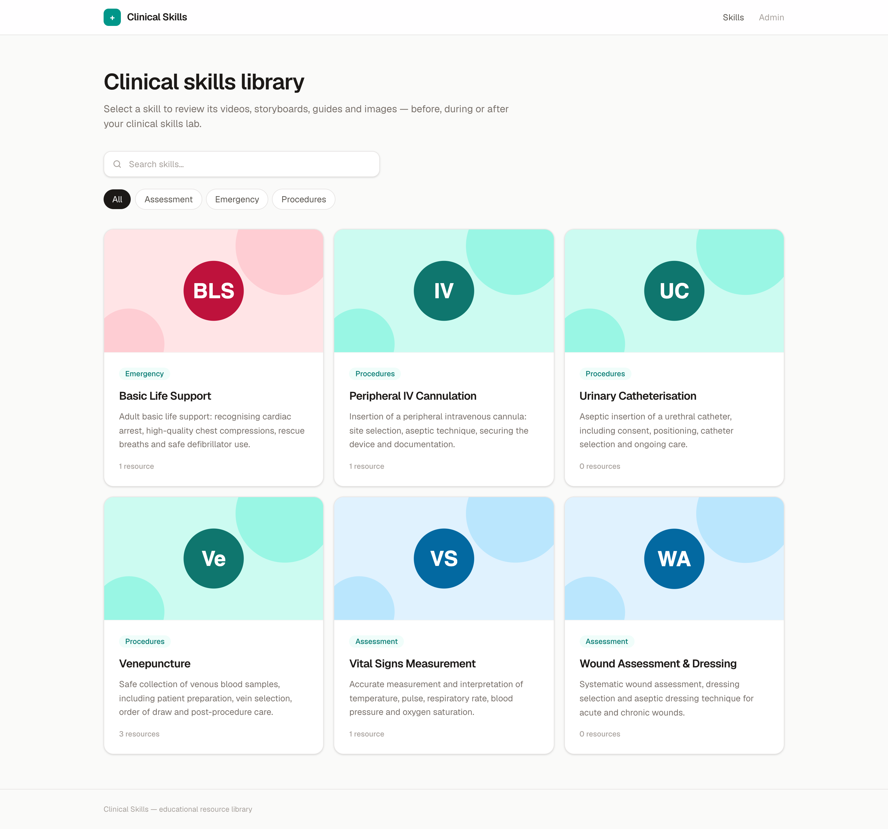
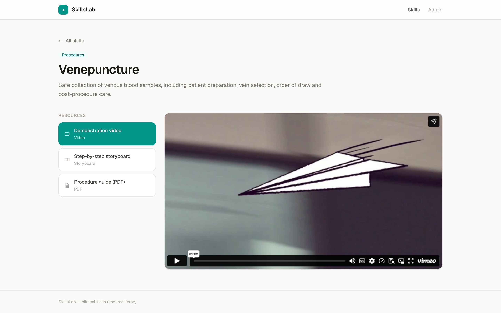
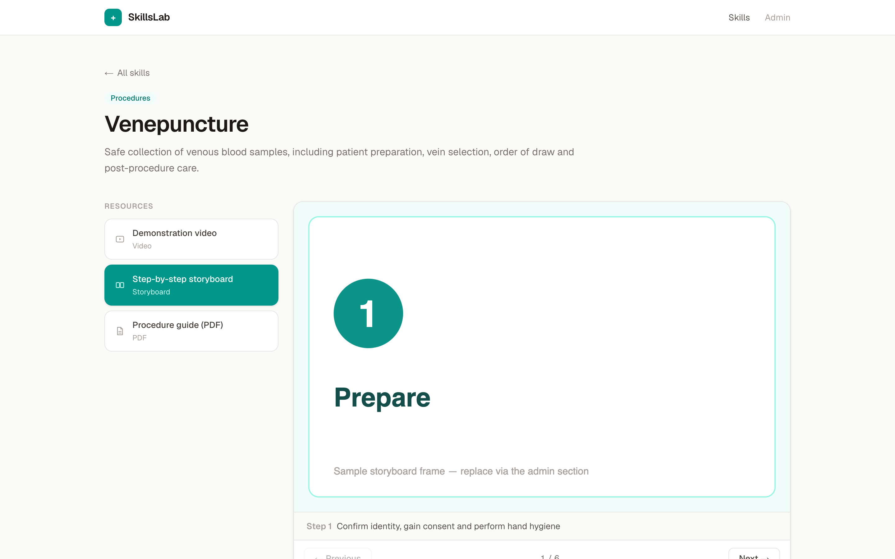
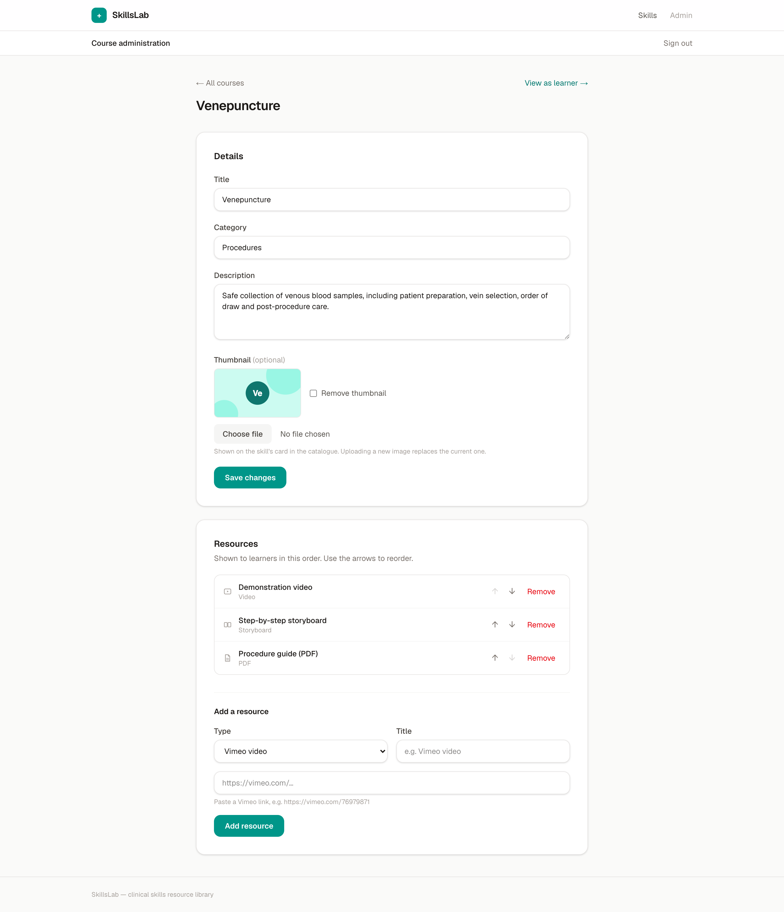
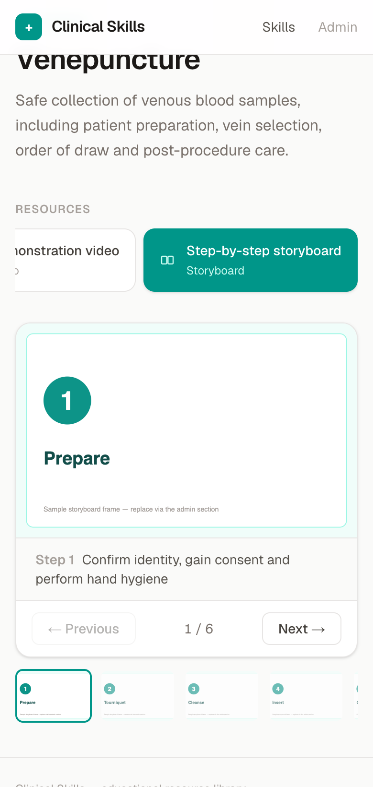

# SkillsLab

**A clean, fast, responsive web app for delivering procedural clinical skills
educational materials.**

PDFs, images, step-by-step storyboards and embedded Vimeo videos. Learners pick
a skill and review its resources before, during or after the clinical skills
lab; administrators manage courses through a simple admin section.



| Resource viewer — embedded video | Storyboards — step-by-step with captions |
| --- | --- |
|  |  |
| **Admin section — course management** | **The same viewer on a phone** |
|  |  |

## Why it exists

Clinical skills teaching material tends to end up scattered: a PDF on a shared
drive, a video on someone's Vimeo account, a photo sequence in a PowerPoint that
only opens properly on one machine. Students ask where the guide is, and the
answer is different every time.

SkillsLab gives each skill one address holding everything for it — the video,
the guide, the step-by-step photos — that works on a phone at the bedside as
well as on a desktop. There is no learner account to create and nothing to log
in to: a student opens the link and reads.

It is deliberately small. There is no assessment, no progress tracking and no
LMS integration; it is a well-organised library, not a learning platform.

## What it does

- **Skill catalogue** — searchable, filterable by group and category, with a
  thumbnail per skill.
- **Resource viewer** — inline PDFs, an image lightbox, step-through storyboards
  with a caption per step, and embedded Vimeo videos (private links with a hash
  are supported).
- **Admin section** — course management behind individual sign-ins: add, edit and remove
  skills, organise them into groups and categories, upload PDFs and images,
  build storyboards, attach Vimeo videos by pasting the URL, and reorder the
  resources shown for each skill.
- **Admin accounts** — each person who manages courses has their own login, as
  an Administrator or an Editor. Administrators create, disable and delete
  accounts and reset passwords; an audit log records who did what.
- **Media library** — every upload in one place, shared between courses: folders,
  tags, search, rename, replace, and a picker on every form.
- **Nothing lost by accident** — resources stay editable after they are added,
  and deletions go to a recycle bin.
- **Responsive** — desktop, tablet and mobile, built minimalist throughout.
- **Zero setup** — the database is created and seeded with example skills on
  first run.

## Run it

### With Docker (recommended)

Pushes to `main` (and `v*` tags) publish a multi-arch image to GitHub Container
Registry. The shipped `compose.yaml` pulls that prebuilt image, so you can
deploy without cloning the repo:

```bash
curl -fsSL https://raw.githubusercontent.com/authorTom/skillslab/main/compose.yaml -o compose.yaml
docker compose up -d
docker compose logs app    # shows the one-time setup code
```

Open **<https://skillslab.localhost/admin>**, accept the browser's warning about
the certificate for now (or [trust Caddy's root](#trusting-the-certificate)),
enter the setup code from the log, and create your administrator account (see
[Admin accounts](#admin-accounts)). Then replace the seeded example skills with
your own. For a real server, set the hostname and certificate first:
[Internal deployment with HTTPS](#internal-deployment-with-https).

Settings go in a `.env` file next to `compose.yaml` (copy
[`.env.example`](.env.example) and edit it) — compose reads it automatically.
Keep that `.env` out of version control.

`compose.yaml` runs two services: the app, and [Caddy](https://caddyserver.com)
in front of it serving HTTPS. Only Caddy is published on the host. `data/` is
kept in a named volume, the app runs under an `init` process, and it has a
healthcheck.

To build from source instead of pulling (multi-stage `Dockerfile`, Next.js
standalone output, runs as a non-root user):

```bash
docker build -t skillslab .
docker run -d -p 3000:3000 -v skillslab-data:/app/data skillslab
```

That serves plain HTTP on port 3000, which is fine for trying it out. Put it
behind HTTPS before anyone signs in over a network: the session cookie is only
marked `Secure` when a proxy says the request arrived over HTTPS.

### From source

```bash
npm install
npm run dev
```

Open <http://localhost:3000>. The database is created and seeded with example
skills on first run, and the terminal prints a setup code for creating the
first administrator at <http://localhost:3000/admin>.

For production: `npm run build && npm start`.

## Internal deployment with HTTPS

SkillsLab is built to run on one server on an internal network, reached by
staff browsers and the iPad app. Sign-ins and the iPad's downloads should go
over HTTPS, so `compose.yaml` puts Caddy in front of the app to terminate TLS.
Caddy also:

- redirects plain HTTP to HTTPS and sends `Strict-Transport-Security`;
- passes the client's address in `X-Forwarded-For` (login throttling and the
  audit log read it) and `X-Forwarded-Proto: https` (which makes the session
  cookie `Secure`).

The app itself is not published on any host port, so nothing can reach it
except through Caddy.

### 1. Choose the hostname

Pick the name people will type, for example `skillslab.trust.internal`, and
have it resolve to the server in your internal DNS. Put it in `.env`:

```bash
SKILLSLAB_HOSTNAME=skillslab.trust.internal
```

The default, `skillslab.localhost`, only works on the server itself and is for
trying things out.

### 2. Choose where the certificate comes from

**Your organisation's internal CA** (recommended where there is one). Ask for a
server certificate for the hostname, and put the certificate (with its
intermediates appended, leaf first) and its private key as PEM files in a
`certs/` folder next to `compose.yaml`:

```bash
SKILLSLAB_TLS=/certs/skillslab.crt /certs/skillslab.key
# SKILLSLAB_CERTS_DIR=./certs     # if the folder is somewhere else
```

The folder is mounted read-only. Devices that already trust your CA (which
managed ones usually do) need nothing more. iPads are strict about server
certificates: the hostname must be in the certificate's Subject Alternative
Name, it must be valid for no more than 398 days, signed with SHA-256 or
better, with an RSA key of at least 2048 bits or an ECDSA key of at least 256.
Renew it before it expires, replace the files and run
`docker compose restart caddy`.

**Caddy's internal CA**, for sites without one. Leave `SKILLSLAB_TLS` unset (or
set it to `internal`). Caddy creates its own root certificate on first start and
issues and renews the server certificate itself. Every device must then trust
that root, below. The root lives in the `caddy-data` volume: keep the volume,
and include it in your server backups, or devices will have to trust a new root
after it is lost.

Then start it:

```bash
docker compose up -d
```

### Trusting the certificate

Staff browsers and iPads must trust whichever CA issued the certificate, or
browsers will warn and the iPad app won't connect at all.

With Caddy's internal CA, copy the root certificate off the server:

```bash
docker compose cp caddy:/data/caddy/pki/authorities/local/root.crt ./skillslab-root.crt
```

- **Managed iPads and Macs:** add the root (yours or Caddy's) to a
  *Certificate* payload in a configuration profile in your MDM and assign it.
  Trust is granted automatically for profiles installed by MDM.
- **Unmanaged iPads:** send the `.crt` file to the device (AirDrop or email),
  install the downloaded profile under *Settings › General › VPN & Device
  Management*, then switch it on under *Settings › General › About ›
  Certificate Trust Settings*. Both steps are needed.
- **Windows PCs:** distribute it through Group Policy to *Trusted Root
  Certification Authorities*.

### Ports

Caddy listens on 443, and on 80 only to redirect. Change them with
`HTTPS_PORT` and `HTTP_PORT` in `.env` if something else on the server already
uses them.

## Configuration

| Variable | Default | What it does |
| --- | --- | --- |
| `ADMIN_PASSWORD` | *(unset)* | Only read while there are no accounts at all: creates the first administrator with this password, which must be changed at first sign-in. Ignored afterwards. Published defaults like `change-me` are refused. |
| `ADMIN_USERNAME` | `admin` | Username for the account `ADMIN_PASSWORD` creates. |
| `SESSION_IDLE_HOURS` | `8` | Sign out after this long without activity. |
| `SESSION_MAX_HOURS` | `12` | Sign out this long after signing in, however active. |

Set them in `.env.local` for local development, or a `.env` beside
`compose.yaml` for a container deployment.

Uploads through the admin section are limited to 50 MB per submission,
configured via `experimental.serverActions.bodySizeLimit` in `next.config.ts`.

Everything else — skills, groups, categories, resources, thumbnails — is managed
in the admin section.

## Admin accounts

Everyone who manages courses signs in to **/admin** with their own username and
password. Learners never need an account.

### The first administrator

A new installation has no accounts. When the server starts it prints a
one-time **setup code** to its log (`docker compose logs app`, or the terminal
running `npm start`). Open **/admin**, enter the code, and choose your name,
username and password. Only someone who can read the server's log can do this;
the code stops working once an administrator exists, and a restart replaces it.

Alternatively, set `ADMIN_PASSWORD` before the first start to create an `admin`
account with it. That account must choose a new password when it first signs in.

**Upgrading from the single shared password?** Nothing to do before upgrading.
On the first start the existing `ADMIN_PASSWORD` becomes the password of an
`admin` account: sign in as **admin** with it, and you'll be asked to choose a
new one. After that `ADMIN_PASSWORD` is ignored — remove it from `.env`.

### Roles

| Role | What they can do |
| --- | --- |
| **Administrator** | Everything: courses, categories, media, offline releases, emptying the recycle bin, user accounts and the audit log. |
| **Editor** | Courses, groups and categories, and the media library. Can restore from the recycle bin, but not delete from it permanently. |

### Managing users

Administrators manage accounts at **/admin/users**:

- **Create** a user with a name, username and role. A temporary password is
  generated and shown once; pass it on, and they choose their own password
  when they first sign in.
- **Reset a password** the same way when someone forgets theirs. Resetting
  signs them out everywhere.
- **Change a role**, **disable** an account (signing it out at once, without
  deleting it), **sign someone out everywhere**, or **delete** an account.
  Deleting an account doesn't touch any course.
- You can't change your own role, disable or delete yourself, and nobody can
  remove the last active administrator.

Everyone can change their own password, and see where they're signed in, from
**/admin/account** (click your name in the admin bar).

### Security

- Passwords are hashed with scrypt; new ones need at least 12 characters and
  can't be a common password or contain the username.
- Five failed sign-ins lock a username for 15 minutes, and repeated failures
  from one address lock that address. The setup code is limited the same way.
- Sessions are kept on the server, so signing out, a password change, a reset
  or disabling an account ends them immediately. Only a hash of each session
  token is stored.
- **/admin/audit** lists sign-ins, failed attempts, account changes, deletions
  and offline releases for a year.

### Locked out?

If no administrator can sign in, run this on the server to reset (or create) an
administrator account. It prints a temporary password:

```bash
docker compose exec app node scripts/reset-admin.mjs <username>   # container
npm run reset-admin -- <username>                                 # source checkout
```

## Organising the catalogue

Courses are organised two levels deep: a **group** holds **categories**, and a
category holds courses — *Core clinical skills › Procedures › Venepuncture*.
Both levels are optional, so a category can sit outside any group and a course
can be left uncategorised.

Manage them at **/admin/categories**: create groups and categories, rename them,
move a category to another group, and reorder both. The order you set is the
order learners see. A course's category is picked on its own edit page, where
**+ New category…** creates one without leaving the form.

Learners get group and category filter chips with course counts above the
catalogue, and the courses themselves are laid out under group and category
headings. Search matches titles, descriptions and category names.

Deleting a group or a category never deletes a course: a deleted group leaves
its categories ungrouped, and a deleted category leaves its courses
uncategorised, where they appear under *Other courses*.

Upgrading an existing installation? The free-text category on each course is
converted into a real category the first time the app starts. Those categories
start out without a group, so open **/admin/categories** to arrange them.

## The media library

Uploads are not owned by the course that first used them. Every file is an item
in the media library at **/admin/media**, and courses point at it — so one PDF or
poster can serve as many courses as you like, uploaded once.

- **Add files** by dragging them onto the library, or from the picker on any
  course or resource form. PNG, JPG, GIF, WebP, AVIF, SVG and PDF are accepted.
- **Organise** with folders (one per file) and tags (as many as you like), then
  filter the library by either, search names, titles and alt text, and sort by
  newest, name or size.
- **Rename freely.** A file's display name and the name it is stored under on
  disk are two different things, so renaming updates every course at once and
  can never leave a broken link — even for a URL someone bookmarked earlier.
- **Edit the details** of any file: its name, a title, alt text for screen
  readers, its folder and its tags. The detail page also lists every course and
  resource using it, and its size, dimensions and type.
- **Replace a file** to publish a new version in place: everything pointing at
  it picks up the new file, the name stays as you set it, and the version it
  replaced goes to the recycle bin.
- **Delete** is refused while anything still uses a file, and says what. Files
  nothing uses go to the recycle bin, and select several with the checkboxes to
  move, tag or delete them together.

Upgrading an existing installation? Every file already in `data/uploads/` is
adopted into the library the first time the app starts, and courses are
repointed at it — including anything left over that no course was using.

## Editing and deleting

Every resource has an **Edit** button (`/admin/resources/<id>`). What you can
change depends on the type: a video's title and Vimeo link; a PDF's or image's
title and which library file it points at; a storyboard's title, per-step
captions, step order and which steps it has. A resource's *type* can't be
changed — remove it and add a new one instead.

Nothing is erased on the first click. Deleting a course, a resource or a library
file moves it to the recycle bin at **/admin/trash** instead:

- **Restore** puts it back — a course returns with its original URL slug,
  thumbnail and resources, re-filed in its category (recreated if that category
  has been deleted meanwhile). Restoring a resource requires its course to
  exist, so if you binned both, restore the course first.
- **Delete forever** and **Empty bin** erase a binned library file from
  `data/uploads/`, which is what actually reclaims the storage. Deleting a
  course or a resource never removes a file: the file belongs to the library, so
  purging it there is the only thing that frees disk space.
- Anything older than 30 days is purged automatically the next time an admin
  page loads. Adjust `TRASH_RETENTION_DAYS` in `src/lib/data.ts` to change that.

## How it's built

- **Next.js** (App Router, TypeScript, React Server Components + Server Actions)
- **Tailwind CSS** for a minimalist, fully responsive UI
- **SQLite** (`better-sqlite3`) — zero-setup local database stored in
  `data/app.db`
- Uploaded files stored in `data/uploads/` and served via `/files/…`, with the
  media library owning them and courses referencing them by id

| Path | Purpose |
| --- | --- |
| `src/app/page.tsx` | Skill catalogue with search and group/category filters |
| `src/app/skills/[slug]/page.tsx` | Skill detail page with the resource viewer |
| `src/components/ResourceViewer.tsx` | PDF viewer, image lightbox, storyboard stepper, Vimeo embed |
| `src/app/admin/` | Admin section: sign-in, course list, skill and resource editors, recycle bin |
| `src/app/admin/users/`, `account/`, `audit/`, `setup/` | User management, your account, audit log, first-run setup |
| `src/app/admin/categories/page.tsx` | Manage groups and categories |
| `src/app/admin/media/` | Media library: browse, upload, edit, replace, delete |
| `src/app/admin/actions.ts` | Server actions: sign-in, course/resource/taxonomy CRUD |
| `src/lib/auth.ts` | Sessions in cookies, `requireUser` / `requireRole` guards |
| `src/lib/users.ts`, `sessions.ts`, `passwords.ts` | Accounts and their rules, server-side sessions, scrypt hashing |
| `src/lib/bootstrap.ts` | First administrator: setup code or `ADMIN_PASSWORD` |
| `src/app/files/[...path]/route.ts` | Serves library files as `/files/<id>/<name>` |
| `src/lib/media.ts` | The media library: uploads, folders, tags, usage, resolving |
| `src/lib/db.ts` | SQLite schema, migrations + first-run seed data |
| `src/lib/data.ts` | Typed query/CRUD helpers |
| `src/lib/trash.ts` | Recycle bin: soft-delete, restore, purge |
| `data/` | Database and uploads (git-ignored — back this up) |

## Backing up and restoring

Everything lives in `data/`: the SQLite database, uploaded files and built
offline releases. A snapshot holds all three.

Don't copy `app.db` by hand, or tar the live volume: the database runs in WAL
mode, so a file copy taken while the app is serving can be missing recent
changes or be corrupt. The backup script uses SQLite's online backup API, which
is safe to run at any time, and checks the copy's integrity.

### Taking a backup

```bash
docker compose exec app node scripts/backup.mjs    # container
npm run backup                                     # source checkout
```

Each run writes a snapshot folder named by the time (UTC) and keeps the 14 most
recent. In a container they go to the `skillslab-backups` volume. A volume on
the same disk won't survive the disk, so point `SKILLSLAB_BACKUP_PATH` in `.env`
at a host folder on other storage (a mounted network share, say), owned by uid
1000, the container's user. From a source checkout they go to `backups/`, or to
`BACKUP_DIR`. `BACKUP_KEEP` changes how many are kept.

To run nightly at 02:00 via cron on the server:

```
0 2 * * * cd /path/to/compose && docker compose exec -T app node scripts/backup.mjs
```

With Caddy's internal CA, also back up the `caddy-data` volume now and then:
it holds the root certificate your devices trust (see
[Trusting the certificate](#trusting-the-certificate)).

### Restoring

List the snapshots, then restore one with the app stopped:

```bash
docker compose exec app node scripts/restore.mjs          # list them
docker compose stop app
docker compose run --rm --no-deps app node scripts/restore.mjs 2026-11-15T02-00-00
docker compose start app
```

From a source checkout, stop the server and run
`node scripts/restore.mjs <snapshot>`.

The restore refuses to run while the app has the database open. `--force`
overrides that, but restart the app straight afterwards. Nothing is deleted:
what was in `data/` is moved to `data/.pre-restore-<time>/` first, for you to
remove once you're happy.

## Licence

MIT — see [LICENSE](LICENSE).
